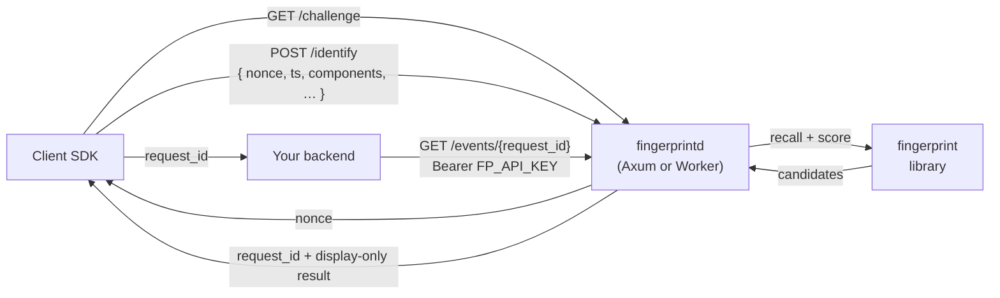

# fingerprintd

[English](./README.md) | [简体中文](./README.zh-CN.md)

Device fingerprinting where the **server**, not the browser, decides who you are. The client only gathers evidence; the server issues a one-time challenge, fuzzy-matches the evidence against its fingerprint library, and returns a `visitor_id` you can trust. The identity is never computed on the client, so it can't be forged or replayed. Your backend reads the authoritative result server-to-server by `request_id`.

```diff
- const visitorId = await fingerprint()          // computed in the browser → forgeable, replayable
+ const { request_id } = await run({ baseUrl, collect })
+ // backend: GET /events/{request_id}  ← computed server-side from a one-time challenge → authoritative
```

## Why

Client-side fingerprinting hands the attacker the algorithm. Whatever the browser computes, a determined script can recompute, pin, or replay — so the "stable id" you gate signups and checkouts on is only as honest as the client chooses to be.

fingerprintd moves the decision to the server:

- **Server-authoritative identity** — the client submits raw signals (canvas, WebGL, fonts, audio, UA…); the server derives the `visitor_id`. A forged client can lie about a signal, but it can't mint an identity.
- **One-time challenge, burned on use** — every `/identify` spends a short-lived nonce and must carry a timestamp inside the server's skew window, so a captured request can't be replayed.
- **Fuzzy matching, not a hash** — a browser upgrade or one font change shouldn't fork a device into a new identity, and two similar devices shouldn't collide. A two-stage recall + probabilistic score handles the drift.
- **Cross-checks it can't forge** — the server compares the client's self-reported UA against the network-layer TLS fingerprint (JA4) and IP risk it observed itself. Self-report vs. observed disagreement is a bot signal the client never controls.
- **One engine, two deployments** — the same compute core runs as a native [Axum server](crates/fingerprintd) and as a [Cloudflare Worker](apps/edge). A client works against either unchanged.

It deliberately does **not** claim unbreakable defense — a sufficiently advanced adversary can forge any single signal. Its value is raising the cost of forgery and cross-checking multiple signals for consistency. It is an anti-fraud tool for high-risk actions (login, signup, checkout, coupon redemption), **not** a cross-site tracker.

## How it works

```
1. GET /challenge          server mints a one-time nonce (short TTL, single-use)
                           → { nonce, expires_in }

2. client collects         components — canvas / webgl / fonts / audio / screen …
                           (closed schema)              → the identity-matching input
                           user_agent, botd, integrity  → risk signals only

3. POST /identify          server: check ts window, burn the nonce (replay protection)
   { nonce, ts,                    → blocking-key recall → Fellegi–Sunter score
     components,                   → fuse passive JA4 / IP signals (UA↔TLS consistency)
     user_agent?, botd?,   → request_id + visitor_id + confidence + decision (+ signals)
     integrity? }

4. GET /events/{request_id}   your backend, Bearer FP_API_KEY
                              → the authoritative identify result
```



The `/identify` response the browser receives is display-only — anything running in the page can tamper with it. Gate decisions on the result your backend fetches with `GET /events/{request_id}`. Passive JA4/IP signals are read from the connection server-side and are never accepted from the client body.

## Endpoints

Both deployments serve the same wire contract.

| Endpoint                 | Method | Purpose                                                          |
| ------------------------ | ------ | ---------------------------------------------------------------- |
| `/health`                | GET    | Liveness (`200 OK`)                                              |
| `/challenge`             | GET    | Issue a one-time nonce challenge                                 |
| `/identify`              | POST   | Compute `visitor_id` + `confidence` + `decision`                 |
| `/events/{request_id}`   | GET    | Authoritative identify result, server-to-server (api-key gated)  |
| `/visitor/{visitor_id}`  | DELETE | GDPR erasure — remove a visitor and its events (admin-key gated) |

`/identify` returns `{ request_id, visitor_id, confidence, decision, is_new_device, collision_risk, signals }`; `GET /events/{request_id}` returns the same body. `decision` is one of `match` / `review` / `new_device`; `confidence` is a decision confidence in `[0,1]`, not identity trust (a brand-new device can score high yet be entirely unestablished — key trust off `is_new_device` / `decision`). Request bodies are a closed snake_case schema: an unknown key at any level is a `400`. The full wire format is in [`packages/client/README.md`](packages/client/README.md).

## Quick start

Run the native server (listens on `127.0.0.1:8080` by default):

```bash
cargo run --bin fingerprintd

# override the bind address
FP_BIND_ADDR=0.0.0.0:9000 cargo run --bin fingerprintd

# probe liveness
curl -i http://127.0.0.1:8080/health
```

Log level is controlled by `RUST_LOG` (defaults to `info`).

Call it from a browser with the SDK — pure TypeScript, it integrates FingerprintJS + BotD and the integrity probes, and submits. It never derives an id:

```bash
npm i @cdlab/fingerprintd
```

```ts
import { createCollector, run } from '@cdlab/fingerprintd'

const result = await run({
  baseUrl: 'https://fp.example.com',
  collect: createCollector(),
})
// Display-only. Send result.request_id to your backend, which calls
// GET /events/{request_id} with Authorization: Bearer <FP_API_KEY>.
```

## Deployment targets

One compute core ([`crates/fp-core`](crates/fp-core), compiled to WASM via [`crates/fp-wasm`](crates/fp-wasm) for the edge) backs every target, so the identity decision is identical across them:

- **Native server** — [`crates/fingerprintd`](crates/fingerprintd), an Axum service with an in-memory store. Start here for self-hosting.
- **Serverless edge** — [`apps/edge`](apps/edge/README.md), a Cloudflare Worker with Durable Object nonce and velocity stores and a libSQL (default) or D1 database.
- **Playground** — [`apps/web`](apps/web/README.md) drives the whole flow in a browser and visualizes what the client sends vs. what the server judges.
- **Check-in risk decision** — the edge Worker also serves `POST /checkin/assess` (`{ account_id, action, request_id }`, `Authorization: Bearer <FP_API_KEY>`). It adds the account/device/IP/time aggregation fingerprintd deliberately doesn't hold and turns a stored identify event into an allow / challenge / deny decision for daily check-in anti-farming; the [playground](apps/web/README.md) demos it.

CI deploys via the manual `deploy-edge` / `deploy-web` workflows. To deploy **from your machine** (rebuild WASM from source → build → push to Cloudflare), use `bun run deploy:cf [edge|web|all]` ([`scripts/deploy-cf.sh`](scripts/deploy-cf.sh)):

```bash
DRY_RUN=1 bun run deploy:cf edge   # build + wrangler dry-run, no account needed
bun run deploy:cf all              # real deploy (wrangler login or CLOUDFLARE_API_TOKEN)
RUN_MIGRATIONS=1 bun run deploy:cf edge   # apply database migrations first
```

Runtime Worker secrets are managed separately with `wrangler secret put`: `FP_SALT_SECRET` (required), `LIBSQL_URL` / `LIBSQL_AUTH_TOKEN` for the default libSQL database, and the optional `FP_API_KEY` / `FP_ADMIN_KEY`. Set `DB_TYPE=d1` to run on D1 instead. See [`apps/edge/README.md`](apps/edge/README.md#deploy) for the full configuration and deploy steps.

## Configuration

The native server is configured lowest → highest priority: built-in defaults → `fingerprintd.toml` → `FP_`-prefixed environment variables. The request timestamp window is always enforced.

| Key                              | Env var                             | Default          | Meaning                                                                     |
| -------------------------------- | ----------------------------------- | ---------------- | --------------------------------------------------------------------------- |
| `bind_addr`                      | `FP_BIND_ADDR`                      | `127.0.0.1:8080` | Listen address.                                                             |
| `nonce_ttl_secs`                 | `FP_NONCE_TTL_SECS`                 | `30`             | One-time nonce lifetime, advertised as `expires_in`.                        |
| `nonce_max_live`                 | `FP_NONCE_MAX_LIVE`                 | `1000000`        | Cap on live (issued, unconsumed) nonces; the oldest is evicted over cap.    |
| `trust_edge_headers`             | `FP_TRUST_EDGE_HEADERS`             | `false`          | Trust edge-injected passive-signal headers (JA4/IP). **Fail-closed:** enable only behind a trusted edge; a directly-reachable origin must leave it off. |
| `integrity_penalty_enabled`      | `FP_INTEGRITY_PENALTY_ENABLED`      | `false`          | Let a `noise` client-integrity verdict lower `/identify` confidence. The verdict is always surfaced as `signals.client_integrity`; off until a real-traffic false-positive rate is known (privacy tooling trips the same probes). |
| `ts_skew_secs`                   | `FP_TS_SKEW_SECS`                   | `30`             | Allowed clock skew of the request `ts`; outside it `/identify` is a `401`.  |
| `fuzzy_max_records`              | `FP_FUZZY_MAX_RECORDS`              | `1000000`        | Max distinct visitors; oldest-seen is evicted over cap.                     |
| `fuzzy_record_ttl_secs`          | `FP_FUZZY_RECORD_TTL_SECS`          | `0`              | Evict records not seen within this window. `0` disables the TTL.            |
| `fuzzy_max_block`                | `FP_FUZZY_MAX_BLOCK`                | `1024`           | Per-block visitor cap for the blocking index; over-cap inserts are dropped. |
| `fuzzy_max_frequency_values`     | `FP_FUZZY_MAX_FREQUENCY_VALUES`     | `1000000`        | Cap on distinct tracked frequency values (`u_i`); new values over cap drop. |
| `fuzzy_max_agreement_components` | `FP_FUZZY_MAX_AGREEMENT_COMPONENTS` | `1024`           | Cap on distinct tracked agreement components (`m_i`); new names over cap drop. |
| `admin_key`                      | `FP_ADMIN_KEY`                      | *(unset)*        | Bearer key gating `DELETE /visitor/{visitor_id}`. Erasure is disabled if unset. |
| `api_key`                        | `FP_API_KEY`                        | *(unset)*        | Bearer key gating `GET /events/{request_id}`. Events are disabled if unset. |
| `event_ttl_secs`                 | `FP_EVENT_TTL_SECS`                 | `3600`           | Lifetime of a stored identify event.                                        |
| `event_max`                      | `FP_EVENT_MAX`                      | `100000`         | Cap on stored identify events; the oldest is evicted over cap.              |
| `retention_secs`                 | `FP_RETENTION_SECS`                 | `0`              | Purge visitor records not seen for this long (seconds). `0` disables the sweep. |
| `request_timeout_secs`           | `FP_REQUEST_TIMEOUT_SECS`           | `10`             | Per-request deadline; past it the request gets `408`.                       |
| `max_concurrent_requests`        | `FP_MAX_CONCURRENT_REQUESTS`        | `1024`           | Global cap on concurrently processed requests; further requests wait.       |

The `admin_key` / `api_key` controls are **fail-closed and off by default** — each endpoint answers `404` until its key is set, and `401` for a missing or wrong bearer. The in-memory capacity bounds are generous and fail-safe: a small workload behaves exactly like an unbounded store, and every eviction or drop is counted, never silent. These settings configure the native server only; the edge Worker has its own configuration (see [`apps/edge/README.md`](apps/edge/README.md#configuration)).

## Project structure

```
crates/
  fp-core/          framework-free compute + storage traits (the shared engine) — crates.io `fingerprintd`
  fingerprintd/     native Axum server (challenge / identify / events / erasure) — crate `fingerprintd-server`, not published
  fp-wasm/          Rust→WASM edge engine (not published; build output for apps/edge)
packages/
  client/           pure-TypeScript browser SDK (FingerprintJS/BotD + integrity probes) — npm `@cdlab/fingerprintd`
apps/
  edge/             Cloudflare Worker: identify + events + /checkin/assess (WASM engine + Durable Objects + libSQL/D1)
  web/              React/Vite playground for the challenge / identify / check-in flow
DESIGN.md           architecture + fuzzy-matching spec (bilingual)
```

`crates/fingerprintd/src/lib.rs` exposes `build_router() -> axum::Router`, the single place HTTP routes are mounted.

## Build & quality gate

The full cross-stack gate is one script, run from anywhere in the repo:

```bash
bash scripts/check.sh
```

It runs, failing on the first red: Rust `cargo fmt --check`, `clippy -D warnings`, `nextest`, `build`, `cargo deny check`; the `fp-wasm` tests; the edge WASM build; then, from the repo root across all workspaces, `bun install --frozen-lockfile`, Biome, typecheck, test, build, and the edge Worker `deploy:dry`.

The deny-warnings policy lives in `[workspace.lints]`; CI runs the same gates (`.github/workflows/`). The Rust and TypeScript stacks are held to one behavior by a shared **parity fixture** exercised on both sides (see [`apps/edge/README.md`](apps/edge/README.md)).

> **Edge WASM.** `apps/edge/wasm` is a build output of [`crates/fp-wasm`](crates/fp-wasm) and is **not committed**; the SDK is pure TypeScript and needs no WASM. It is rebuilt from source on demand (only on a fresh clone or after `bun run clean`; a normal install never recompiles).
>
> - With a **Rust toolchain + `wasm-pack`** installed, a plain `bun install` builds it automatically:
>
>   ```bash
>   bun install   # builds the edge WASM (if missing) + the SDK
>   ```
>
> - **Without** the Rust toolchain, install still succeeds and builds the SDK but skips the edge WASM — build it once the toolchain is available:
>
>   ```bash
>   bun run build:wasm   # wasm-pack build crates/fp-wasm -> apps/edge/wasm
>   bun run build        # then builds the SDK + apps
>   ```
>
> Install `wasm-pack` with `cargo install wasm-pack`.

Per-component tooling:

- **SDK** — `cd packages/client && bunx @biomejs/biome check . && bun run typecheck && bun run test`
- **Edge Worker** — `cd apps/edge && bun run test` (node project + miniflare workers project: routes / stores / Durable Objects / parity / check-in)
- **Playground** — `cd apps/web && bun run typecheck && bun run build`
- **Anti-detect browser harness** (manual, needs Docker) — `bash scripts/redteam/cloak/run.sh` runs the real SDK collector inside a fingerprint-noising browser (CloakBrowser) and stock Chromium; curated captures live in `crates/fp-core/tests/fixtures/cloakbrowser/` and drive `crates/fp-core/tests/cloakbrowser_fixtures.rs`. See [`scripts/redteam/cloak/README.md`](scripts/redteam/cloak/README.md).

## Publishing

Two artifacts are published under one name, from one version (the Cargo workspace version and `packages/client/package.json` must agree; currently `0.1.0`):

| Artifact | Registry | Install |
|---|---|---|
| Browser SDK | npm `@cdlab/fingerprintd` | `npm i @cdlab/fingerprintd` |
| Compute engine | crates.io `fingerprintd` | `cargo add fingerprintd` |

The native server (`crates/fingerprintd`, crate `fingerprintd-server`) is a deployable, not a library, and is not published; run it from the repo with `cargo run --bin fingerprintd`. `crates/fp-wasm` is not published either: it is a wasm-pack build output bundled into the edge Worker.

Releases run from [`.github/workflows/release.yml`](.github/workflows/release.yml): bump the version in both manifests, then push a matching tag:

```bash
git tag v0.1.0 && git push origin v0.1.0
```

The workflow verifies the tag against both manifests, tests and builds the SDK, publishes it to npm, publishes `fingerprintd` to crates.io, and finally creates a GitHub Release for the tag with generated notes. Each publish step skips a version the registry already has. It needs the `NPM_TOKEN` and `CARGO_REGISTRY_TOKEN` repository secrets. **The first release of a new package/crate must be token-based on both registries**; afterwards you can register the workflow as a trusted publisher (npm package settings / crates.io crate settings), remove the secrets, and the workflow falls back to OIDC. To publish once from a workstation instead:

```bash
bun install && (cd packages/client && bun run build && npm publish)
cargo publish -p fingerprintd --locked
```

## Design

[`DESIGN.md`](DESIGN.md) ([中文](DESIGN.zh-CN.md)) is the authoritative spec: the architecture (background, threat model, the freshness-vs-identity split, the passive-signal trust boundary, HTTP contract, privacy and compliance, deployment targets) and the fuzzy-matching engine (two-stage blocking + Fellegi–Sunter scoring, drift, cold start, offline evaluation).

## Security

See [`SECURITY.md`](SECURITY.md) for the vulnerability-reporting policy. No secret ships to the browser: the one-time nonce, the enforced timestamp window and TLS are the freshness guarantees, and the API and admin keys stay server-side.

## License

[Apache-2.0](LICENSE)
