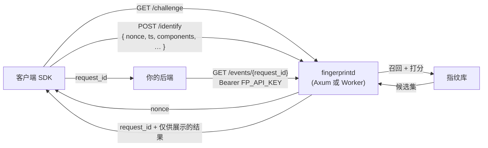

# fingerprintd

[English](./README.md) | [简体中文](./README.zh-CN.md)

由**服务端**、而非浏览器决定"你是谁"的设备指纹服务。客户端只负责采集证据;服务端签发一次性 challenge、把证据与指纹库做模糊匹配,返回一个可信的 `visitor_id`。身份从不在客户端计算,因此无法被伪造或重放。你的后端按 `request_id` 以服务端到服务端的方式读取权威结果。

```diff
- const visitorId = await fingerprint()          // 在浏览器里计算 → 可伪造、可重放
+ const { request_id } = await run({ baseUrl, collect })
+ // 后端:GET /events/{request_id}  ← 由一次性 challenge 在服务端计算 → 权威可信
```

## 为什么

客户端指纹等于把算法交到攻击者手里。浏览器算出来的任何东西,一个有心的脚本都能重算、固定或重放 —— 于是你用来把关注册和下单的那个"稳定 id",只在客户端愿意诚实时才可信。

fingerprintd 把判定搬到服务端:

- **服务端权威身份** —— 客户端提交原始信号(canvas、WebGL、字体、音频、UA…),由服务端派生 `visitor_id`。伪造的客户端能在某个信号上撒谎,但铸造不出一个身份。
- **一次性 challenge,用后即焚** —— 每次 `/identify` 都消耗一个短时效 nonce,且必须携带落在服务端时钟偏移窗口内的时间戳,被截获的请求无法重放。
- **模糊匹配,而非哈希** —— 浏览器升级或换一个字体不该把一台设备分裂成新身份,两台相似设备也不该相撞。两阶段召回 + 概率打分吸收这种漂移。
- **它伪造不了的交叉校验** —— 服务端把客户端自报的 UA 与它**自己观测到**的网络层 TLS 指纹(JA4)和 IP 风险对比。自报与实测的不一致,是客户端控制不了的机器人信号。
- **一个引擎,两种部署** —— 同一个计算核心既作为原生 [Axum 服务](crates/fingerprintd)运行,也作为 [Cloudflare Worker](apps/edge) 运行。客户端对两者无感切换。

它刻意**不**宣称牢不可破 —— 足够高级的对手能伪造任意单一信号。它的价值在于**抬高伪造成本**并对多个信号做一致性交叉校验。它是用于高风险动作(登录、注册、下单、优惠券核销)的反欺诈工具,**不是**跨站追踪器。

## 工作原理

```
1. GET /challenge          服务端铸造一次性 nonce(短 TTL、单次使用)
                           → { nonce, expires_in }

2. 客户端采集              components —— canvas / webgl / 字体 / 音频 / 屏幕 …
                           (封闭 schema)                → 身份匹配的输入
                           user_agent、botd、integrity  → 仅作风险信号

3. POST /identify          服务端:校验 ts 窗口,烧掉 nonce(防重放)
   { nonce, ts,                    → blocking-key 召回 → Fellegi–Sunter 打分
     components,                   → 融合被动 JA4 / IP 信号(UA↔TLS 一致性)
     user_agent?, botd?,   → request_id + visitor_id + confidence + decision(+ signals)
     integrity? }

4. GET /events/{request_id}   你的后端,Bearer FP_API_KEY
                              → 权威的 identify 结果
```



浏览器收到的 `/identify` 响应**仅供展示** —— 页面里运行的任何代码都能篡改它。请基于你的后端用 `GET /events/{request_id}` 取回的结果做判定。被动 JA4/IP 信号在服务端从连接层读取,**绝不**从客户端请求体接受。

## 接口

两种部署提供同一套线上契约。

| 端点                     | 方法   | 用途                                                       |
| ------------------------ | ------ | ---------------------------------------------------------- |
| `/health`                | GET    | 存活探测(`200 OK`)                                        |
| `/challenge`             | GET    | 签发一次性 nonce challenge                                 |
| `/identify`              | POST   | 计算 `visitor_id` + `confidence` + `decision`              |
| `/events/{request_id}`   | GET    | 权威的 identify 结果,服务端到服务端(需 api-key 门控)    |
| `/visitor/{visitor_id}`  | DELETE | GDPR 擦除 —— 删除一个 visitor 及其事件(需 admin-key 门控) |

`/identify` 返回 `{ request_id, visitor_id, confidence, decision, is_new_device, collision_risk, signals }`;`GET /events/{request_id}` 返回同一个 body。`decision` 为 `match` / `review` / `new_device` 之一;`confidence` 是 `[0,1]` 区间的**判定置信度**,不是身份可信度(一台全新设备可以打分很高却毫无历史 —— 请以 `is_new_device` / `decision` 为准来判断可信度)。请求体是封闭的 snake_case schema:任意层级出现未知键都返回 `400`。完整线上格式见 [`packages/client/README.md`](packages/client/README.md)。

## 快速开始

运行原生服务(默认监听 `127.0.0.1:8080`):

```bash
cargo run --bin fingerprintd

# 覆盖监听地址
FP_BIND_ADDR=0.0.0.0:9000 cargo run --bin fingerprintd

# 探测存活
curl -i http://127.0.0.1:8080/health
```

日志级别由 `RUST_LOG` 控制(默认 `info`)。

用 SDK 从浏览器调用 —— 纯 TypeScript,集成 FingerprintJS + BotD 与完整性探针,然后提交。它从不派生 id:

```bash
npm i @cdlab/fingerprintd
```

```ts
import { createCollector, run } from '@cdlab/fingerprintd'

const result = await run({
  baseUrl: 'https://fp.example.com',
  collect: createCollector(),
})
// 仅供展示。把 result.request_id 发给你的后端,由后端带
// Authorization: Bearer <FP_API_KEY> 调用 GET /events/{request_id}。
```

## 部署目标

同一个计算核心([`crates/fp-core`](crates/fp-core),边缘侧经 [`crates/fp-wasm`](crates/fp-wasm) 编译为 WASM)支撑每一个目标,因此身份判定在各处完全一致:

- **原生服务** —— [`crates/fingerprintd`](crates/fingerprintd),一个带内存存储的 Axum 服务。自托管从这里开始。
- **无服务器边缘** —— [`apps/edge`](apps/edge/README.md),一个 Cloudflare Worker,用 Durable Object 存 nonce 与 velocity,数据库为 libSQL(默认)或 D1。
- **Playground** —— [`apps/web`](apps/web/README.md) 在浏览器里跑通整个流程,可视化客户端**发送**了什么、服务端**判定**了什么。
- **签到风控判定** —— edge Worker 还提供 `POST /checkin/assess`(`{ account_id, action, request_id }`,`Authorization: Bearer <FP_API_KEY>`)。它补上 fingerprintd 刻意不持有的账号/设备/IP/时序聚合,把一条已存储的 identify 事件转成用于每日签到反刷的 allow / challenge / deny 决策;由 [playground](apps/web/README.md) 演示。

CI 通过手动的 `deploy-edge` / `deploy-web` workflow 部署。要**从本机**部署(从源码重建 WASM → 构建 → 推送到 Cloudflare),用 `bun run deploy:cf [edge|web|all]`([`scripts/deploy-cf.sh`](scripts/deploy-cf.sh)):

```bash
DRY_RUN=1 bun run deploy:cf edge   # 构建 + wrangler dry-run,无需账号
bun run deploy:cf all              # 真正部署(需 wrangler login 或 CLOUDFLARE_API_TOKEN)
RUN_MIGRATIONS=1 bun run deploy:cf edge   # 先执行数据库迁移
```

Worker 运行时 secret 单独用 `wrangler secret put` 管理:`FP_SALT_SECRET`(必需)、默认 libSQL 数据库所需的 `LIBSQL_URL` / `LIBSQL_AUTH_TOKEN`,以及可选的 `FP_API_KEY` / `FP_ADMIN_KEY`。设置 `DB_TYPE=d1` 则改用 D1。完整配置与部署步骤见 [`apps/edge/README.md`](apps/edge/README.md#deploy)。

## 配置

原生服务按优先级从低到高配置:内置默认 → `fingerprintd.toml` → `FP_` 前缀的环境变量。请求时间戳窗口始终强制校验。

| 键                               | 环境变量                            | 默认值           | 含义                                                                        |
| -------------------------------- | ----------------------------------- | ---------------- | --------------------------------------------------------------------------- |
| `bind_addr`                      | `FP_BIND_ADDR`                      | `127.0.0.1:8080` | 监听地址。                                                                  |
| `nonce_ttl_secs`                 | `FP_NONCE_TTL_SECS`                 | `30`             | 一次性 nonce 时效,作为 `expires_in` 通告。                                 |
| `nonce_max_live`                 | `FP_NONCE_MAX_LIVE`                 | `1000000`        | 存活(已签发、未消耗)nonce 的上限;超限时淘汰最早的。                     |
| `trust_edge_headers`             | `FP_TRUST_EDGE_HEADERS`             | `false`          | 是否信任边缘注入的被动信号头(JA4/IP)。**Fail-closed:**仅在可信边缘之后开启;可直连的源站必须关闭。 |
| `integrity_penalty_enabled`      | `FP_INTEGRITY_PENALTY_ENABLED`      | `false`          | 是否允许 `noise` 的客户端完整性判定下调 `/identify` 置信度。判定始终以 `signals.client_integrity` 展示;在拿到真实流量误报率之前保持关闭(隐私工具会触发同样的探针)。 |
| `ts_skew_secs`                   | `FP_TS_SKEW_SECS`                   | `30`             | 请求 `ts` 允许的时钟偏移;超出则 `/identify` 返回 `401`。                   |
| `fuzzy_max_records`              | `FP_FUZZY_MAX_RECORDS`              | `1000000`        | 最大不同 visitor 数;超上限时淘汰最早见到的。                              |
| `fuzzy_record_ttl_secs`          | `FP_FUZZY_RECORD_TTL_SECS`          | `0`              | 淘汰在此窗口内未再见到的记录。`0` 关闭 TTL。                               |
| `fuzzy_max_block`                | `FP_FUZZY_MAX_BLOCK`                | `1024`           | blocking 索引每块的 visitor 上限;超限的插入被丢弃。                       |
| `fuzzy_max_frequency_values`     | `FP_FUZZY_MAX_FREQUENCY_VALUES`     | `1000000`        | 跟踪的不同频率值(`u_i`)上限;超限的新值被丢弃。                          |
| `fuzzy_max_agreement_components` | `FP_FUZZY_MAX_AGREEMENT_COMPONENTS` | `1024`           | 跟踪的不同一致性组件(`m_i`)上限;超限的新组件名被丢弃。                  |
| `admin_key`                      | `FP_ADMIN_KEY`                      | *(未设置)*       | 门控 `DELETE /visitor/{visitor_id}` 的 Bearer 密钥。未设置则擦除接口禁用。 |
| `api_key`                        | `FP_API_KEY`                        | *(未设置)*       | 门控 `GET /events/{request_id}` 的 Bearer 密钥。未设置则事件接口禁用。     |
| `event_ttl_secs`                 | `FP_EVENT_TTL_SECS`                 | `3600`           | 已存储 identify 事件的时效。                                               |
| `event_max`                      | `FP_EVENT_MAX`                      | `100000`         | 已存储 identify 事件的上限;超限时淘汰最早的。                             |
| `retention_secs`                 | `FP_RETENTION_SECS`                 | `0`              | 清除超过此时长(秒)未再见到的 visitor 记录。`0` 关闭清扫。                 |
| `request_timeout_secs`           | `FP_REQUEST_TIMEOUT_SECS`           | `10`             | 单请求截止时间;超时返回 `408`。                                            |
| `max_concurrent_requests`        | `FP_MAX_CONCURRENT_REQUESTS`        | `1024`           | 全局并发处理请求上限;其余请求排队等待。                                    |

`admin_key` / `api_key` 两项控制**默认 fail-closed 且关闭** —— 在设置密钥之前对应接口返回 `404`,缺失或错误的 bearer 返回 `401`。内存容量上限宽松且 fail-safe:小负载表现得与无界存储完全一致,每一次淘汰或丢弃都会被计数,绝不静默。这些设置只配置原生服务;edge Worker 有自己的配置(见 [`apps/edge/README.md`](apps/edge/README.md#configuration))。

## 项目结构

```
crates/
  fp-core/          无框架的计算 + 存储 trait(共享引擎)—— crates.io `fingerprintd`
  fingerprintd/     原生 Axum 服务(challenge / identify / events / 擦除)—— crate `fingerprintd-server`,不发布
  fp-wasm/          Rust→WASM 的边缘引擎(不发布;apps/edge 的构建产物)
packages/
  client/           纯 TypeScript 浏览器 SDK(FingerprintJS/BotD + 完整性探针)—— npm `@cdlab/fingerprintd`
apps/
  edge/             Cloudflare Worker:identify + events + /checkin/assess(WASM 引擎 + Durable Object + libSQL/D1)
  web/              challenge / identify / 签到流程的 React/Vite playground
DESIGN.md           架构 + 模糊匹配规格(双语)
```

`crates/fingerprintd/src/lib.rs` 暴露 `build_router() -> axum::Router`,是 HTTP 路由唯一的挂载点。

## 构建与质量门

完整的跨栈质量门就是一个脚本,可在仓库内任意位置运行:

```bash
bash scripts/check.sh
```

它依次运行、遇红即停:Rust 的 `cargo fmt --check`、`clippy -D warnings`、`nextest`、`build`、`cargo deny check`;`fp-wasm` 测试;边缘 WASM 构建;然后在仓库根目录对所有 workspace 运行 `bun install --frozen-lockfile`、Biome、typecheck、test、build,以及边缘 Worker 的 `deploy:dry`。

deny-warnings 策略写在 `[workspace.lints]` 里;CI 跑同样的门(`.github/workflows/`)。Rust 与 TypeScript 两套栈由一份共享的 **parity fixture** 在两侧同时验证,保持行为一致(见 [`apps/edge/README.md`](apps/edge/README.md))。

> **边缘 WASM。** `apps/edge/wasm` 是 [`crates/fp-wasm`](crates/fp-wasm) 的构建产物,**不提交进仓库**;SDK 是纯 TypeScript,不需要 WASM。它按需从源码重建(仅全新 clone 或 `bun run clean` 之后;正常安装不会重新编译)。
>
> - 装了 **Rust 工具链 + `wasm-pack`** 时,直接 `bun install` 会自动构建:
>
>   ```bash
>   bun install   # 缺失时构建边缘 WASM + SDK
>   ```
>
> - **没有** Rust 工具链时,install 仍会成功并构建 SDK、但跳过边缘 WASM —— 工具链就绪后手动构建一次:
>
>   ```bash
>   bun run build:wasm   # wasm-pack build crates/fp-wasm -> apps/edge/wasm
>   bun run build        # 之后构建 SDK + apps
>   ```
>
> 用 `cargo install wasm-pack` 安装 wasm-pack。

各组件工具链:

- **SDK** —— `cd packages/client && bunx @biomejs/biome check . && bun run typecheck && bun run test`
- **边缘 Worker** —— `cd apps/edge && bun run test`(node 项目 + miniflare workers 项目:路由 / 存储 / Durable Object / parity / 签到)
- **Playground** —— `cd apps/web && bun run typecheck && bun run build`
- **反检测浏览器 harness**(手动,需要 Docker)—— `bash scripts/redteam/cloak/run.sh` 在指纹加噪浏览器(CloakBrowser)和原生 Chromium 中运行真实的 SDK 采集器;精选捕获放在 `crates/fp-core/tests/fixtures/cloakbrowser/`,驱动 `crates/fp-core/tests/cloakbrowser_fixtures.rs`。见 [`scripts/redteam/cloak/README.md`](scripts/redteam/cloak/README.md)。

## 发布

对外发布两个产物,同名、同版本号(Cargo workspace 版本与 `packages/client/package.json` 必须一致;当前为 `0.1.0`):

| 产物 | 仓库 | 安装 |
|---|---|---|
| 浏览器 SDK | npm `@cdlab/fingerprintd` | `npm i @cdlab/fingerprintd` |
| 计算引擎 | crates.io `fingerprintd` | `cargo add fingerprintd` |

原生服务(`crates/fingerprintd`,crate 名 `fingerprintd-server`)是可部署程序而非库,不发布,在仓库内用 `cargo run --bin fingerprintd` 运行。`crates/fp-wasm` 同样不发布:它是 wasm-pack 构建产物,打包进边缘 Worker。

发布由 [`.github/workflows/release.yml`](.github/workflows/release.yml) 执行:同时提升两个清单里的版本号,再推送同名 tag:

```bash
git tag v0.1.0 && git push origin v0.1.0
```

工作流校验 tag 与两个清单一致,测试并构建 SDK、发布到 npm,把 `fingerprintd` 发布到 crates.io,最后为该 tag 创建带自动生成说明的 GitHub Release。仓库中已存在的版本会被各发布步骤跳过。需要仓库 secrets `NPM_TOKEN` 与 `CARGO_REGISTRY_TOKEN`。**新包/新 crate 的首次发布在两个仓库都必须用 token**;之后可把该工作流注册为 trusted publisher(npm 包设置 / crates.io crate 设置)、删除 secrets,工作流会自动回退到 OIDC。若要在本机一次性发布:

```bash
bun install && (cd packages/client && bun run build && npm publish)
cargo publish -p fingerprintd --locked
```

## 设计

[`DESIGN.zh-CN.md`](DESIGN.zh-CN.md)([English](DESIGN.md))是权威规格:架构(背景、威胁模型、新鲜度与身份的拆分、被动信号信任边界、HTTP 契约、隐私与合规、部署目标)与模糊匹配引擎(两阶段 blocking + Fellegi–Sunter 打分、漂移、冷启动、离线评估)。

## 安全

漏洞报告策略见 [`SECURITY.md`](SECURITY.md)。没有任何密钥下发到浏览器:一次性 nonce、强制的时间戳窗口与 TLS 提供新鲜度保证,API 与 admin 密钥只留在服务端。

## 许可证

[Apache-2.0](LICENSE)
